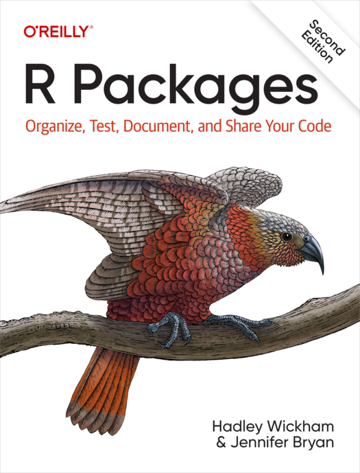



## Today

### Distributing and Organizing Code

Workshop in creating an R package

# Why Write a Package?

## Organizing Code

::: {.columns}
::::: {.column width="47%"}
### Components

In any given project, you may have:

- Code for experiments\pause
- Source code (which we may want to reuse)\pause
- Tests\pause
- Rcpp code\pause
- Data

\medskip\pause

How do we organize this?
:::::

. . .

::::: {.column width="47%"}
### Sourcing

One way is to just keep R scripts and source them as needed.

\medskip\pause

But this puts the burden on you to keep track of where things are and in what
order to source them.

\medskip\pause

Reusability is limited.

. . .

### R Package

Another way is to make an R package!

\medskip\pause

This forces you to organize your code, and gives you tools to manage
dependencies, testing, data, documentation, and C++ integration.
:::::
:::

## Including Functions

::: {.columns}
::::: {.column width="47%"}
### Without a Package

Need to keep track of where your functions are defined or source manually.

. . .

```{r}
#| eval: false
#| label: including-functions

source("path/to/some/file1.R")
source("path/to/some/file2.R")

my_first_function()
my_second_function()
```
:::::

. . .

::::: {.column width="47%"}
### With a Package

You can just do:

```{r}
#| eval: false
#| label: including-functions-package

library(mypkg)

my_first_function()
my_second_function()
```

. . .

or `mypkg::my_first_function()`{.r} if you don't want to attach the whole
package.
:::::
:::

## Testing

::: {.columns}
::::: {.column width="47%"}
### Without a Package

Previously, we needed to manually run scripts to test our code: store them in
some folder and call

```r
testthat::test_dir("<folder>")
```
:::::

. . .

::::: {.column width="47%"}
### With a Package

With a package, we can use

```r
devtools::test()
```

to run all tests in the package.

\medskip\pause

And tests are run automatically when checking the package.
:::::
:::

## Dependencies

::: {.columns}
::::: {.column width="47%"}
### Without a Package

If your code depends on other packages, you need to:

1. Make sure they are installed using `install.packages()`{.r}.\pause
2. Load them using `library()`{.r} at the right places (or call `pkg::fun()`{.r}
   directly).
:::::

::::: {.column width="47%"}
. . .

### With a Package

Dependencies are declared in the `DESCRIPTION` file of your package.

\medskip\pause

When installing your package, dependencies are installed automatically.
:::::
:::

## C++ Integration (Rcpp)

::: {.columns}
::::: {.column width="47%"}
### Without a Package

You need to manually source C++ files using `Rcpp::sourceCpp()`{.r}.

\medskip\pause

Need to specify dependencies manually using special comments in the C++ code:

```cpp
// [[Rcpp::depends(RcppEigen)]]
```
:::::

. . .

::::: {.column width="47%"}
### With a Package

Rcpp code lives in `src/` and is compiled automatically when installing the
package.

\medskip\pause

Dependencies on other Rcpp packages (RcppArmadillo, RcppEigen) are handled
automatically through `DESCRIPTION`.
:::::
:::

## Data

::: {.columns}
::::: {.column width="47%"}
### Without a Package

You need to keep track of where data files are located and load them manually.

```{r}
#| eval: false
#| code-style:
#|   line-width: 32
#| label: r

mydata <- read.csv(
  "path/to/mydata.csv"
)
```
:::::

. . .

::::: {.column width="47%"}
### With a Package

Data can be included in the package in `data/` and directly available (if
exported) as `mypkg::mydata`{.r}.
:::::
:::

## Publishing

If you find out that your code is useful to others, you can publish it on CRAN
or GitHub.

\medskip\pause

And if you've already made a package, this is straightforward!

# Writing an R Package

## R Packages

::: {.columns align="center"}
::::: {.column width="50%"}
Different approaches, but we will follow **R
Packages**\ [@wickhamPackagesOrganizeTest2023], which is based around the
**devtools** package.
:::::

::::: {.column width="35%"}
{.border}
:::::
:::

## devtools

Meta-package for various helpers that aid in developing R packages (and
projects).

\medskip

First off, install and load **devtools**:

```r
install.packages("devtools")
library(devtools)
```

\medskip\pause

::: {.columns align="center"}
::::: {.column width="54%"}
### usethis

This loads other packages that will be useful for setting up your package, such
as the **usethis** package.
:::::

::::: {.column width="40%"}
{width=50%}{width=50%}
:::::
:::

## A Toy Example

### Rosenbrock Package

Let's build a simple package that solves the Rosenbrock optimization problem,
i.e. find
$$
  \theta^*
  = \argmin_{\theta}\Big((a - \theta_1)^2 + b(\theta_2 - \theta_1^2)^2\Big).
$$

. . .

### What We Will Learn

::: {.incremental}
- Adding R functions to our package
- Testing our code
- Interfacing with Rcpp
- Adding dependencies to other packages
- Licensing our package
- Documenting the code
:::

## A First Package

### Create It

Use RStudio^[`File -> New Project -> New Directory -> R Package Using Devtools`]
or call

```r
usethis::create_package("rosenbrock")
```

\medskip\pause

::: {.columns}
::::: {.column width="47%"}
Gives you a **minimal** package:

\medskip

\dirtree{%
  .1 rosenbrock/.
  .2 R/.
  .2 DESCRIPTION.
  .2 NAMESPACE.
}
:::::

. . .

::::: {.column width="47%"}
You may also have `.Rbuildignore` and `rosenbrock.Rproj` depending on how you
created the package.
:::::
:::

## Install It

Open up the package in your editor (R
Studio\footnote{In which case it should
already be opened.}).

```r
devtools::install()
```

. . .

Voila, you have made an R package!

\medskip\pause

If you're in RStudio, you can also click the "Build" tab and then "Install and
Restart"\footnote{\texttt{Ctrl/Cmd+Shift+B}}.

## R Code

### `R/`

- All R code should live in `.R`-files in `R/`.\pause
- These files should usually only contain **functions**.\pause
- Many ways to organize your files: one function per file, all functions of a
  certain S3 class in one file etc.\pause

\medskip

Let's create a first file: `R/objective.R`.

\medskip\pause

Call `usethis::use_r("objective")`{.r} and insert

```r
objective <- function(x, a = 1, b = 100) {
  (a - x[1])^2 + b * (x[2] - x[1]^2)^2
}
```

## Workflow

We have created a first R file, now what? Two major options:

::: {.columns}
::::: {.column width="47%"}
### `devtools::install()` {.r}

Installs the package, like calling `install.packages()`{.r}.

\medskip\pause

Robust but slow. Need to call `library(rosenbrock)`{.r} to load package.
:::::

. . .

::::: {.column width="47%"}
### `devtools::load_all()`{.r}\footnote[frame]{\texttt{Ctrl/Cmd+Shift+L}}

Simulates loading the package without installing it, for instance sources all R
files in `R/`.

\medskip\pause

Quick but not as robust.

\medskip\pause

Good for regular development.
:::::
:::

\medskip\pause

### Try It {.example}

Try both options and see if you can call your newly defined function,
`objective()`{.r}.

##

{width=92% .border}

## Exporting Functions

If you called `devtools::load_all()`{.r} then everything is sourced and you can
just call `objective()`{.r} directly.

\medskip\pause

But if you use `devtools::install()`{.r} and `library(rosenbrock)`{.r}, then you
would need to use `rosenbrock:::objective()`{.r}. The reason is that the
function is not yet exported.

. . .

### NAMESPACE

Decides what functions you want exported. But right now it just contains a
comment:

```r
# Generated by roxygen2: do not edit by hand
```

## roxygen2

**roxygen2** is a package that helps with package documentation, but it can also
be used for handling the namespace.

\medskip\pause

To export a function, you need a special roxygen2 comment before the function:

```r
#' @export
```

. . .

Go ahead and place this before your `objective()`{.r} definition. Then run
`devtools::document()`{.r}^[Shortcut: `Ctrl/Cmd+Shift+D`] to roxygenize your
package.

\medskip\pause

Now `NAMESPACE` will (should) contain this:

```r
export(objective)
```

\medskip\pause

Reinstall the package and see if you can call `objective()`{.r} after loading
it.

## Tests

### testthat

Let's start using **testthat** with our package:

```r
usethis::use_testthat()
```

. . .

This creates some new files and directories:

\medskip

\dirtree{%
  .1 rosenbrock/.
  .2 tests/.
  .3 testthat/.
  .4 <currently-empty>.
  .3 testthat.R.
}

## A First Simple Test

For $b > 0$, the Rosenbrock function has its unique minimum at $(a, a^2)$, where
$f(a, a^2) = 0$. With the defaults $a = 1$ and $b = 100$, this gives
$f(1, 1) = 0$. Let's make sure this is the case for us too!

\medskip\pause

To create a test, we can use `usethis::use_test()`{.r}.

\medskip\pause

Call `use_test("objective")`{.r} and insert this:

```r
test_that("objective at optimum", {
  # add a test using expect_equal()
})
```

. . .

### Check That Everything Works

Run `devtools::test()`{.r}^[Shortcut: `Ctrl/Cmd+Shift+T`], and (hopefully) get

```
[ FAIL 0 | WARN 0 | SKIP 0 | PASS 1 ]
```

## Checking

### R CMD check

R contains functionality for checking that your package is built correctly and
you can access this functionality through `devtools::check()`{.r}^[Shortcut:
`Ctrl/Cmd+Shift+E`].

\medskip\pause

No requirement that your package needs to pass these checks (if you're using it
as a project), but it's good practice to make sure it does.

\medskip\pause

ERROR
:   Major problem with your package\pause

WARNING
:   Something that is most likely not great but not critical\pause

NOTE
:   Typically small issues with your package

\medskip\pause

Now run `devtools::check()`{.r}. Is there a problem?

\medskip\pause

Yes, the license placeholder needs replacing, and `objective()`{.r} is missing
documentation. We will fix both.

## Metadata

The metadata for your package lives in `DESCRIPTION`. Right now it looks like
this:

```dcf
Package: rosenbrock
Title: What the Package Does (One Line, Title Case)
Version: 0.0.0.9000
Authors@R:
    person("First", "Last", , "first.last@example.com", <...>)
Description: What the package does (one paragraph).
License: `use_mit_license()`, `use_gpl3_license()` or friends
    to pick a license
Encoding: UTF-8
Roxygen: list(markdown = TRUE)
RoxygenNote: 8.0.0
```

For now we'll leave most of these files alone, but let's fix one thing: the
license

## Licensing

### Why Do You Need a License?

Licensing software tells other people about how they are allowed to reuse your
code.

\medskip\pause

If you do not provide a license, this generally means that **nobody is allowed
to copy, distribute, or modify your code.**

\medskip\pause

If you have other contributors, then "nobody" includes **you too!**

. . .

### Personal Projects

For a small personal project, licensing is overkill, at least if you are not
sharing it with others.

## Choosing a License

So we need to pick a license: for now we'll pick the MIT license.\
(Read more about picking a license at <https://choosealicense.com>.)

```r
usethis::use_mit_license()
```

. . .

This will add new files to your package: `LICENSE`, `LICENSE.md`, and modify
`DESCRIPTION`, in which you should see:

```
License: MIT + file LICENSE
```

## Dependencies

In R packages, you make dependencies explicit, defined in `DESCRIPTION`.

. . .

### Computing the Gradient

Let's say that we want to use **numDeriv** to numerically compute the gradient
for the Rosenbrock function.

```r
gradient <- function(x, a = 1, b = 100) {
  numDeriv::grad(objective, x, a = a, b = b)
}
```

. . .

Now our package depends on **numDeriv**, so we need to add it to `DESCRIPTION`:

```r
usethis::use_package("numDeriv")
```

. . .

In `DESCRIPTION`, you should now see this:

```
Imports:
  numDeriv
```

## Rcpp

::: {.columns}
::::: {.column width="48%"}
Rcpp works best in a package:

- No more manual sourcing (no need to call `Rcpp::sourceCpp()`{.r})\pause
- You don't need to add directives for dependencies to **RcppArmadillo** and
  other packages.

\medskip\pause

We will rely on **roxygen2**. First, call

```r
usethis::use_package_doc()
```

to set up a package doc file in `R/rosenbrock-package.R`.
:::::

. . .

::::: {.column width="42%"}
Then use `usethis::use_rcpp("objective")`{.r}, which sets up Rcpp by modifying
`DESCRIPTION` and setting up the namespace via roxygen2.

\medskip\pause

It also creates a `src/` folder with a C++ file containing the Rcpp include and
namespace declaration:

\medskip

\dirtree{%
  .1 rosenbrock/.
  .2 src/.
  .3 objective.cpp.
}

\bigskip\pause

Run `devtools::document()`{.r} to update `NAMESPACE`, then install or load your
package.
:::::
:::

## Exporting Rcpp Code

::: {.columns}
::::: {.column width="52%"}
### Wrapping

Mark the C++ function with `// [[Rcpp::export]]`, then call it through an R
wrapper:

```r
#' @export
my_fun <- function() my_fun_cpp()
```

. . .

Typically easier because checking input and preparing output is easier on the R
side.
:::::

. . .

::::: {.column width="42%"}
### Direct Export

You can add roxygen2 comments in Rcpp code too:

```cpp
//' @export
// [[Rcpp::export]]
double
my_fun_cpp()
{
  ...
}
```

. . .

Saves you having to write and maintain an R function.
:::::
:::

\medskip\pause

Run `devtools::document()`{.r} after adding export tags, then reinstall the
package to make the exported functions available to users.

## Documentation

::: {.columns}
::::: {.column width="47%"}
### Why?

Because

- you make your code accessible to others,\pause
- it makes you think an extra time about what your function is doing, and\pause
- your future self will thank you.
:::::

. . .

::::: {.column width="47%"}
### Types

- Comments in code\pause
- Manual (help files)\pause
- Long-form articles (vignettes)
:::::
:::

\medskip\pause

### roxygen2

Primary purpose of the roxygen2 package. You write code in a special syntax and
it converts it into manual files that R understands.

## roxygen2 Syntax

```r
#' Function Title
#'
#' Here you describe what the function does, possibly using
#' several lines.
#'
#' @param x Explanation of argument x
#'
#' @return Explanation of what the function returns
#'
#' @export
my_fun <- function(x) ...
```

. . .

### Your Turn

Document `objective()`{.r} with roxygen2 syntax. No need for sensible
documentation. Just make sure you have the bare minimum.

\medskip\pause

Document any other exported functions too, then run `devtools::document()`{.r}
to generate the help files.

## Documentation in This Course

- Not making a package for CRAN, so lower standards.
- You don't need to document to benefit from building a package.
- But it's not a bad idea to do so anyway!

##


## Shortcuts

Use the shortcuts (and save yourself some typing/clicking):^[Replace `Ctrl` with
`Cmd` on Mac.]

  | Action           | Shortcut       |
  | :--------------- | :------------- |
  | Install package  | `Ctrl+Shift+B` |
  | Load all code    | `Ctrl+Shift+L` |
  | Document package | `Ctrl+Shift+D` |
  | Test package     | `Ctrl+Shift+T` |
  | Check package    | `Ctrl+Shift+E` |

## Projects

::: {.columns align="center"}
::::: {.column width="47%"}
When you have a project, you typically need more things:

- Scripts that produce output\pause
- Datasets stored in different formats\pause
- Notebooks or reports\pause

\medskip

These things do not naturally fit into a package framework.
:::::

. . .

::::: {.column width="47%"}
### Solutions

1. Just store these things directly in the package folder. \pause
2. Put your **package** into a *subdirectory* of your project. This cleanly
   separates the part of your project that contains reusable code (the package)
   and the part that is experiments and reports. But a little trickier to setup.
:::::
:::

## Exercise

Continue building the **rosenbrock** package!

### Step 1

Write a function `optimize_banana()`{.r} that uses `optim()`{.r} to solve the
Rosenbrock problem. It should take as input `a`, `b`, and a starting point `x0`,
and return the optimal point and function value.

. . .

### Step 2

Write an implementation of the gradient using Rcpp. Let the user choose whether
to use the gradient or not in `optimize_banana()`{.r}.

\medskip

Use `method = "BFGS"` in `optim()`{.r}, and pass the gradient as `gr`, or
`gr = NULL` to use finite differences. The default Nelder--Mead method ignores
`gr`.

. . .

### Step 3

Return an S3 object of class `banana` from `optimize_banana()`{.r}, and then
write an S3 plot method `plot.banana()`{.r} that plots the contours of the
Rosenbrock function and the optimum found in `optimize_banana()`{.r}.

## Summary

We have learned how to create an R package, add R and Rcpp code, test it,
document it, and manage dependencies and licensing.

. . .

### What We Didn't Cover

- Version control (git)\pause
- How to properly format metadata (`DESCRIPTION`)\pause
- Integrating data into our package\pause
- Publishing to CRAN\pause
- Reproducibility (renv)

## References
