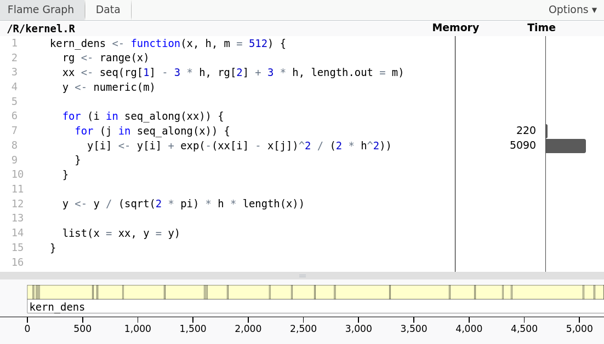
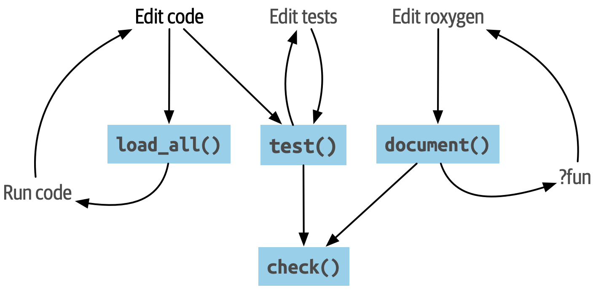



## Today

### Course Summary

What did we actually do?

. . .

### Oral Examination

What to think of during examination and general tips for oral presentations.

. . .

### Q&A

Tell me what you want to know more about, and I will try to answer.

. . .

# Course Summary

## Kernel Density Estimation

::: {.columns align="center"}
::::: {.column width="47%"}
Average kernels centered at the observations:
$$
  \hat{f}_h(x) = \frac{1}{hN} \sum_{j=1}^N K\left( \frac{x - x_j}{h} \right).
$$

\medskip\pause

The bandwidth, $h$, controls the **bias--variance trade-off**.
:::::

::::: {.column width="47%"}
```{r}
#| label: recap-kde
#| echo: false
#| fig-cap: Illustration of kernel density estimation with a Gaussian kernel.

x <- c(-1, 3, 5, 6, 9)
N <- length(x)

l <- lapply(x, function(xi) {
  a <- seq(-4, 4, length.out = 100)
  d <- dnorm(a) / N
  data.frame(x = xi, a = a + xi, d = d)
})

res <- do.call(rbind, l)

p1 <- ggplot() +
  xlim(c(-5, 15)) +
  ylim(c(0, 0.15)) +
  labs(x = "x", y = "Density")

p2 <- p1 +
  geom_rug(
    aes(x),
    data = tibble(x = x),
    linewidth = 1,
    col = "navy"
  )

p3 <- p2 +
  geom_line(aes(a, d, group = x), col = "darkorange", data = res)

p4 <- p3 + geom_density(aes(x), bw = 1, data = tibble(x = x))

p4
```
:::::
:::

## Scatterplot Smoothing

::: {.columns align="center"}
::::: {.column width="47%"}
Estimate a smooth relationship from noisy observations.

\medskip\pause

Nearest neighbors or smoothing splines: choose the smoothing level by
**cross-validation**.

\medskip\pause

Smoothing splines use a penalized least-squares criterion:
$$
  \sum_{i=1}^N (y_i - f(x_i))^2
  + \lambda \underbrace{\int f''(z)^2 \ \mathrm{d}z}_{\|f''\|_2^2}
$$
:::::

::::: {.column width="47%"}
<!-- Figure from lecture 4: nuuk-spline-opt2. -->

```{r}
#| label: recap-smoothing-data
#| include: false
#| message: false

nuuk <- read_table(
  here::here("data", "nuuk.txt"),
  col_names = c("Year", 1:12),
  na = "-999",
  skip = 1
) |>
  gather(
    key = "Month",
    value = "Temperature",
    -Year,
    convert = TRUE
  ) |>
  mutate(Temperature = Temperature / 10) |>
  filter(Year > 1866)

nuuk_year <- group_by(nuuk, Year) |>
  summarise(
    Temperature = mean(Temperature),
    Median = median(Temperature),
    High = max(Temperature),
    Low = min(Temperature)
  )
N <- nrow(nuuk_year)

nuuk_plot <- ggplot(nuuk_year, aes(Year, Temperature)) +
  geom_point()
```

```{r}
#| label: recap-smoothing
#| echo: false
#| fig-cap: Scatterplot of annual mean temperatures in Nuuk, Greenland, with a
#|   smoothing spline.

smooth <- smooth.spline(nuuk_year$Year, nuuk_year$Temperature)
nuuk_plot + geom_line(aes(y = smooth$y), color = "blue")
```
:::::
:::

## Rejection Sampling

::: {.columns align="center"}
::::: {.column width="47%"}
Propose from an easy distribution, then accept or reject.

\medskip\pause

The envelope must **dominate the target**. A tighter envelope wastes fewer
proposals.
:::::

::::: {.column width="47%"}
<!-- Figure from lecture 5: rejection-sampling-ggplot. -->

```{r}
#| label: recap-rejection
#| echo: false

set.seed(1)
N <- 1000
y <- runif(N, 0, 9)
u <- runif(N, 0, 0.43)
target <- function(x) {
  ifelse(
    x > 0 & x < 9,
    dnorm(x, 5, 1) / (pnorm(9, 5, 1) - pnorm(0, 5, 1)),
    0
  )
}
envelope <- function(x) rep(0.43, length(x))

accepted <- u <= target(y)
df <- data.frame(y = y, u = u, accepted = accepted)

curve_df <- data.frame(
  x = seq(0, 9, length.out = 200),
  target = target(seq(0, 9, length.out = 200)),
  envelope = envelope(seq(0, 9, length.out = 200))
)

ggplot() +
  geom_line(data = curve_df, aes(x = x, y = envelope)) +
  geom_area(
    data = curve_df,
    aes(x = x, y = target),
    col = "black",
    fill = "grey90"
  ) +
  geom_point(
    data = df,
    aes(x = y, y = u, color = accepted),
    size = 0.5
  ) +
  scale_color_manual(
    values = c("red", "steelblue2"),
    labels = c("Rejected", "Accepted")
  ) +
  labs(x = "y", y = "Density", color = NULL) +
  guides(color = guide_legend(position = "inside")) +
  theme(
    legend.position.inside = c(0.98, 0.98),
    legend.justification.inside = c(1, 1),
    legend.background = element_rect(fill = "white", color = NA)
  )
```
:::::
:::

## Monte Carlo and Importance Sampling

::: {.columns align="center"}
::::: {.column width="47%"}
Estimate expectations by averaging random draws.

\medskip\pause

### Importance Sampling

Change the sampling distribution and reweight. Support and tails matter.
:::::

::::: {.column width="47%"}
<!-- Figure from lecture 6: rare-event-comparison. -->

```{r}
#| label: recap-mc-data
#| include: false

n_rare <- 10000

set.seed(2026)
p_rare <- pnorm(4, lower.tail = FALSE)
rare_estimates <- replicate(500, {
  z <- rnorm(n_rare)
  x <- rnorm(n_rare, mean = 4)
  c(MC = mean(z > 4), IS = mean((x > 4) * exp(8 - 4 * x)))
})

rare_runs <- tibble(
  run = seq_len(ncol(rare_estimates)),
  MC = rare_estimates["MC", ],
  IS = rare_estimates["IS", ]
) |>
  pivot_longer(
    c(MC, IS),
    names_to = "method",
    values_to = "estimate"
  ) |>
  mutate(
    method = factor(
      method,
      levels = c("MC", "IS"),
      labels = c("Ordinary MC", "Importance sampling")
    )
  )
```

```{r}
#| label: recap-mc
#| echo: false

ggplot(rare_runs, aes(run, estimate / p_rare, color = method)) +
  geom_hline(yintercept = 1, linetype = "dashed") +
  geom_point(size = 0.6, alpha = 0.6) +
  facet_wrap(vars(method), ncol = 1) +
  scale_color_manual(
    values = c(
      "Ordinary MC" = "royalblue",
      "Importance sampling" = "darkorange"
    )
  ) +
  guides(color = "none") +
  labs(x = "Run", y = expression(hat(p) / p))
```
:::::
:::

## Optimization

Gradient descent uses gradients. Newton also uses curvature.

\bigskip

```{r}
#| label: recap-optimization-data
#| include: false

source(here::here("R", "lecture7-comparison.R"))

optimization_problem <- logistic_comparison_problem(
  1000,
  2,
  design_condition = 8,
  seed = 71
)
optimization_start <- c(0, 0)
optimization_value <- logistic_evaluate(
  optimization_start,
  optimization_problem
)$loss
optimization_gradient <- logistic_gradient(
  optimization_start,
  optimization_problem
)
optimization_hessian <- logistic_hessian(
  optimization_start,
  optimization_problem
)
optimization_minimum <- fit_logistic_comparison(
  optimization_problem,
  "Newton"
)$beta

gd_step <- optimization_start -
  optimization_gradient / optimization_problem$L
newton_step <- optimization_start -
  solve(optimization_hessian, optimization_gradient)
optimization_steps <- tibble(
  method = c("Gradient descent", "Newton"),
  beta1 = c(gd_step[1], newton_step[1]),
  beta2 = c(gd_step[2], newton_step[2])
)

optimization_grid <- expand_grid(
  beta1 = seq(-4, 1, length.out = 121),
  beta2 = seq(-4, 1, length.out = 121)
)
optimization_offsets <- sweep(
  as.matrix(optimization_grid),
  2,
  optimization_start
)
optimization_linear <- optimization_value +
  drop(optimization_offsets %*% optimization_gradient)
optimization_levels <- optimization_value +
  c(-0.2, -0.1, 0, 0.2, 0.4)

optimization_grid <- optimization_grid |>
  mutate(
    objective = apply(
      as.matrix(optimization_grid),
      1,
      function(beta) {
        logistic_evaluate(beta, optimization_problem)$loss
      }
    ),
    `Gradient descent` = optimization_linear +
      optimization_problem$L *
        rowSums(optimization_offsets^2) /
        2,
    Newton = optimization_linear +
      rowSums(
        (optimization_offsets %*% optimization_hessian) *
          optimization_offsets
      ) /
        2
  ) |>
  pivot_longer(
    c("Gradient descent", "Newton"),
    names_to = "method",
    values_to = "model"
  )
```

```{r}
#| label: recap-optimization
#| echo: false
#| fig-width: 5.0
#| fig-height: 2.3
#| fig-cap: "Gray: logistic objective. Dashed: quadratic models. Arrows minimize each
#|   model."

ggplot(optimization_grid, aes(beta1, beta2)) +
  geom_contour(
    aes(z = objective),
    breaks = optimization_levels,
    color = "grey65"
  ) +
  geom_contour(
    aes(z = model, color = method),
    breaks = optimization_levels,
    linetype = "dashed"
  ) +
  geom_segment(
    data = optimization_steps,
    aes(
      x = optimization_start[1],
      y = optimization_start[2],
      xend = beta1,
      yend = beta2,
      color = method
    ),
    arrow = grid::arrow(length = grid::unit(0.08, "inches"))
  ) +
  geom_point(
    data = optimization_steps,
    aes(color = method),
    size = 2
  ) +
  annotate(
    "point",
    x = optimization_start[1],
    y = optimization_start[2],
    size = 2
  ) +
  annotate(
    "point",
    x = optimization_minimum[1],
    y = optimization_minimum[2],
    shape = 4,
    size = 2
  ) +
  facet_wrap(vars(method)) +
  scale_color_manual(
    values = c(
      "Gradient descent" = "royalblue",
      Newton = "darkorange"
    ),
    guide = "none"
  ) +
  scale_x_continuous(breaks = c(-4, -2, 0)) +
  scale_y_continuous(breaks = c(-4, -2, 0)) +
  coord_fixed(expand = FALSE) +
  labs(x = expression(beta[1]), y = expression(beta[2]))
```

\pause

**Cheap steps or fewer steps?** Conditioning and problem size matter.

\pdfpcnote{
  - Both models match the objective and gradient at the same starting point.\\
  - Gradient descent uses $LI$; Newton uses the Hessian of the objective.\\
  - A full Newton step minimizes the local model, so it need not reach the optimum.\\
}

## Stochastic Gradient Descent

::: {.columns align="center"}
::::: {.column width="47%"}
Use a random observation or mini-batch to estimate the gradient.

\medskip\pause

**Learning rates, batch sizes, and momentum** control progress and noise.
:::::

::::: {.column width="47%"}
<!-- Figure from lecture 11: logistic-regression-paths. -->

```{r}
#| label: recap-sgd
#| echo: false
#| fig-keep: last
#| fig-height: 3.2
#| dev.args: { bg: white, pointsize: 9 }

library(mvtnorm)
source(here::here("R", "sgd.R"))

set.seed(123)

N <- 1000
p <- 2
Sigma <- matrix(c(1, 0.8, 0.8, 1), nrow = 2)
mu <- c(0, 0)

X <- rmvnorm(N, mean = mu, sigma = Sigma)
beta <- c(1, 2)
y <- rbinom(N, 1, plogis(X %*% beta))

res_glm <- glm.fit(X, y, family = binomial())

loss_2d <- function(beta1, beta2, X, y) {
  beta <- c(beta1, beta2)
  z <- X %*% beta
  p_hat <- 1 / (1 + exp(-z))
  -mean(y * log(p_hat) + (1 - y) * log(1 - p_hat))
}

beta1 <- seq(-1, 3, length = 100)
beta2 <- seq(-1, 3, length = 100)

loss_2d_vectorized <- Vectorize(function(b1, b2) {
  loss_2d(b1, b2, X, y)
})

z <- outer(beta1, beta2, loss_2d_vectorized)

res_sgd <- logreg_sgd(X, y, max_epochs = 100, batch_size = 1)
res_gd <- logreg_sgd(X, y, max_epochs = 100, batch_size = N)

pal <- palette.colors(palette = "Okabe-Ito")

sgd_reveals <- c(0L, 1L, 5L, 20L, 100L, 1000, 10000)

for (steps in sgd_reveals) {
  contour(
    beta1,
    beta2,
    z,
    col = "dark grey",
    drawlabels = FALSE,
    asp = 1,
    main = sprintf("SGD updates: %d", steps)
  )

  lines(
    res_gd$beta_history[1, ],
    res_gd$beta_history[2, ],
    col = pal[1]
  )
  points(
    res_gd$beta_history[1, ],
    res_gd$beta_history[2, ],
    col = pal[1],
    pch = 19,
    cex = 0.5
  )

  if (steps > 0L) {
    path <- seq_len(steps + 1L)
    lines(
      res_sgd$beta_history[1, path],
      res_sgd$beta_history[2, path],
      col = pal[3]
    )
    points(
      res_sgd$beta_history[1, steps + 1L],
      res_sgd$beta_history[2, steps + 1L],
      col = pal[3],
      pch = 19,
      cex = 0.9
    )
  }

  points(
    res_glm$coefficients[1],
    res_glm$coefficients[2],
    col = pal[2],
    pch = 19,
    cex = 1
  )

  legend(
    "bottomright",
    legend = if (steps > 0L) c("SGD", "GD") else "GD",
    col = if (steps > 0L) pal[c(3, 1)] else pal[1],
    pch = 19,
    cex = 0.8
  )
}
```
:::::
:::

## The EM Algorithm

::: {.columns align="center"}
::::: {.column width="47%"}
### E-Step

Take conditional expectations.

### M-Step

Maximize the resulting $Q$-function.

\medskip\pause

The likelihood does not decrease, but EM can be slow and **initialization
matters**.
:::::

::::: {.column width="47%"}
<!-- Figure from lecture 9: em-lower-bound. -->

```{r}
#| label: recap-em
#| echo: false
#| fig-keep: 2

library(ggplot2)

# A Gaussian latent-variable model gives exact bounds for this illustration:
# Z ~ N(theta, 1), X | Z ~ N(Z, 1), and the observed value is X = 2.
# All curves omit the same additive constant.
em_loglik <- function(theta) -(theta - 2)^2 / 4
em_bound <- function(theta, current) {
  em_loglik(theta) - (theta - current)^2 / 4
}

em_theta <- numeric(5)
em_theta[1] <- -1
for (i in seq_len(4)) {
  em_theta[i + 1] <- (em_theta[i] + 2) / 2
}

em_curve <- data.frame(theta = seq(-1.4, 4.5, length.out = 401))
em_curve$loglik <- em_loglik(em_curve$theta)

for (i in seq_len(4)) {
  current <- em_theta[i]
  next_theta <- em_theta[i + 1]
  em_curve$bound <- em_bound(em_curve$theta, current)
  history <- data.frame(
    theta = em_theta[seq_len(i)],
    value = em_loglik(em_theta[seq_len(i)])
  )

  p <- ggplot(em_curve, aes(x = theta)) +
    geom_line(aes(y = loglik, color = "likelihood")) +
    geom_line(aes(y = bound, color = "bound")) +
    geom_point(
      data = history,
      aes(y = value),
      color = "grey60"
    ) +
    geom_vline(
      xintercept = current,
      color = "grey60",
      linetype = "dashed"
    ) +
    scale_color_manual(
      name = NULL,
      values = c(likelihood = "royalblue", bound = "darkorange"),
      breaks = c("likelihood", "bound"),
      labels = expression(
        italic(l) * (theta),
        italic("F") * (q[n] * "," ~ theta)
      )
    ) +
    guides(color = guide_legend(position = "inside")) +
    theme(
      legend.position.inside = c(0.98, 0.02),
      legend.justification.inside = c(1, 0),
      legend.background = element_rect(
        fill = "white",
        color = NA
      )
    ) +
    coord_cartesian(xlim = c(-1.4, 4.5), ylim = c(-3, 0.25)) +
    labs(x = expression(theta), y = "Value")

  print(
    p +
      annotate(
        "point",
        x = current,
        y = em_loglik(current),
        color = "royalblue",
        size = 2.5
      ) +
      labs(
        title = sprintf("Iteration %d: E-step", i),
        subtitle = "Make the bound tight at the current parameter"
      )
  )

  print(
    p +
      geom_vline(
        xintercept = next_theta,
        color = "grey60",
        linetype = "dashed"
      ) +
      annotate(
        "segment",
        x = next_theta,
        xend = next_theta,
        y = em_bound(next_theta, current),
        yend = em_loglik(next_theta),
        color = "royalblue"
      ) +
      annotate(
        "point",
        x = next_theta,
        y = em_bound(next_theta, current),
        color = "darkorange",
        fill = "white",
        shape = 21,
        size = 2.5
      ) +
      annotate(
        "point",
        x = next_theta,
        y = em_loglik(next_theta),
        color = "royalblue",
        size = 2.5
      ) +
      labs(
        title = sprintf("Iteration %d: M-step", i),
        subtitle = "Move to the maximum of the bound"
      )
  )
}
```
:::::
:::

## Accuracy

::: {.columns}
::::: {.column width="47%"}
### Testing

Check known answers, edge cases, and numerical tolerances.

\bigskip

\centering

{width=60%}
:::::

. . .

::::: {.column width="47%"}
### Debugging

Isolate the problem and inspect intermediate values.

\bigskip

\begin{figure}
  \begin{tikzpicture}
    \duck[stethoscope=gray!80!black]
  \end{tikzpicture}
\end{figure}
:::::
:::

## Measuring Performance

::: {.columns}
::::: {.column width="47%"}
### Profiling

Where does the time go?

\bigskip

{width=100%}

\medskip\pause
:::::

::::: {.column width="47%"}
### Benchmarking

Compare implementations on the same task and check their results.

```{r}
#| label: recap-benchmark-data
#| echo: false
#| fig-height: 1.7
#| fig-cap: "Benchmarking the square root function."

library(bench)

x <- runif(100)
sqrt_bench <- bench::mark(sqrt(x), x^0.5)
plot(sqrt_bench)
```
:::::
:::

## Improving Performance

::: {.columns align="center"}
::::: {.column width="47%"}
**Vectorize** work, avoid copies, and **parallelize** independent tasks.

\medskip\pause

Use **C++** through Rcpp for bottlenecks that remain.
:::::

::::: {.column width="47%"}
<!-- Figure from lecture 3: custom-bench-plot-code. -->

```{r}
#| label: recap-performance-data
#| include: false
#| message: false
#| warning: false
#| fig-cap: Vectorization improves performance of kernel density estimation.

source(here::here("R", "kernel.R"))

dens_bench <- bench::press(N = 2^(6:9), {
  x <- rnorm(N)
  bench::mark(
    base = density(x, 0.2),
    loop = kern_dens(x, 0.2),
    vectorized = kern_dens_vec(x, 0.2),
    check = FALSE # density() uses a different approximation.
  )
})
```

```{r}
#| label: recap-performance
#| echo: false

mutate(dens_bench, method = as.character(expression)) |>
  ggplot(aes(N, median, color = method)) +
  geom_point() +
  geom_line() +
  labs(y = "time (s)", color = NULL) +
  guides(color = guide_legend(position = "inside")) +
  theme(
    legend.position.inside = c(0.02, 0.98),
    legend.justification.inside = c(0, 1),
    legend.background = element_rect(fill = "white", color = NA)
  )
```
:::::
:::

## Organizing Code

::: {.columns align="center"}
::::: {.column width="40%"}
### OOP

Classes describe results; methods define behavior.

\medskip\pause

### R Packages

Keep code, tests, documentation, and dependencies together.
:::::

::::: {.column width="55%"}
<!-- Figure from lecture 14: Documentation in This Course. -->

{width=100%}
:::::
:::

# Oral Examination

## Procedure

::: {.incremental}
1. After entering the room you will connect the computer and check that it works
   with the projector.
2. When all technical issues are settled, you will draw the assignment and find
   the presentation on the computer.
3. Time starts and you have 15 min for the presentation. We may ask questions if
   something needs to be clarified.
4. After 15 min your presentation will be stopped, and the examiners will ask
   questions related to the assignment as well as to the general content of the
   course.
5. After at most 25 min the exam ends, and after assessment you will be given a
   grade.
:::

## Recommendations

::: {.incremental}
- You should prepare a presentation that covers the assignments.
- You don't need to have covered *everything* in detail, but you should show
  that you understand the main concepts.
- For a good grade, you need to have studied at least part of the assignment in
  detail.
- We expect you to use slides. Aim for around 15 slides.
- Use plenty of plots. Pick out important code snippets.
- Practice your presentation.
- Keep your code available in case we want to see something.
:::

## Giving Effective Presentations

The following advice are heavily inspired by blog posts by Claus Wilke.

## Tell a Story

To show us you've understood the material, it helps to tell a story.

\medskip\pause

Show us how you arrived at your results---not just the results themselves.

. . .

### Example

1. First, I tried method A.\pause
2. But I realized I had to wait for a long time for my implementation to
   finish.\pause
3. Then I profiled my code and found a bottleneck.\pause
4. I fixed the bottleneck using method B.\pause
5. Here's a comparison of the results from method A and method B.\pause

## Read Out All of the Text on Your Slides

::: {.columns}
::::: {.column width="47%"}
### Synchronization

Your audience can both read your slides and listen to you, but not if you are
talking about something else than what is on the slide.

\medskip\pause

They will either read the slide or listen to you, but not both.

### Too Much Text?

If this makes you think

> No way will I have time to read all of this aloud!

Then very likely you have **too much text** on your slides.
:::::

::::: {.column width="47%"}
:::::
:::

## Practice Your Presentation

### Run It Through

Run through the entire presentation. Even just reading the slides aloud is
helpful.

. . .

### The Speed-Run

If you are short on time:

- Go through your slides one-by-one\pause
- Try to guess what the next slide is!

# Questions and Answers

## Number of Optimization Methods

### Question

> How many optimization methods would you recommend comparing with the EM
> algorithm in Assignment 3A? Are there any particular methods you would suggest
> including?

\medskip\pause

### Answer

- One or two is enough.\pause
- Pick one or two methods that are **different** from EM, e.g., gradient descent
  and Newton's method. Let your interest in the methods guide your choice.\pause

::: {.standout}
##

Thank you, and good luck!
:::

## References
